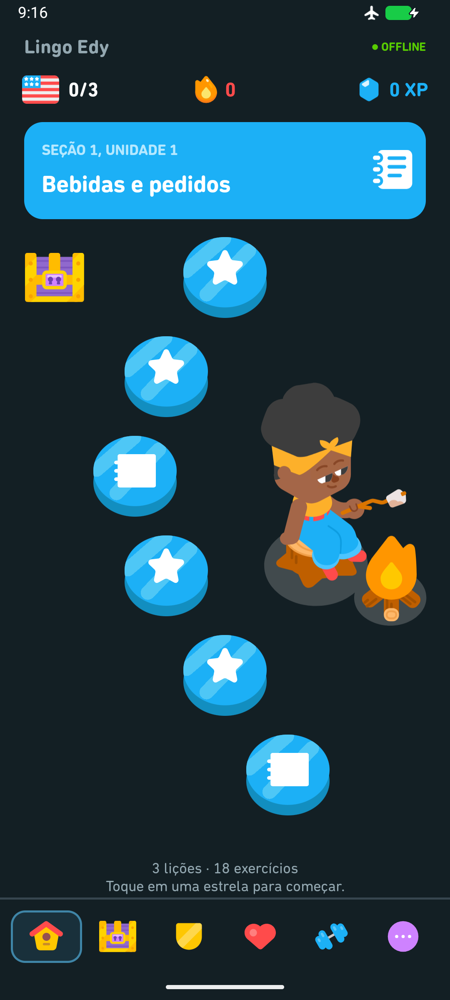

# Primeira unidade com áudio, sem servidor

O **Lingo Edy** é uma implementação Android independente para começar a
transformar o material importado em lições utilizáveis offline. O pacote é
`dev.edney.lingolocal`; ele pode coexistir com o Duolingo e com a reconstrução
anterior. Nenhum arquivo do aplicativo no celular foi alterado nesta etapa.

**Atualização:** a prática Cores e roupas acrescenta sete atividades, personagens
animados e fala offline com Vosk. São quatro lições e 25 exercícios no aplicativo.
Há agora permissão opcional de microfone, solicitada ao gravar, e continua sem
permissão de internet. Veja a [documentação atual das atividades](ATIVIDADES.md).
As seções abaixo registram também a implementação e as validações anteriores.

## Visual Lingo Edy

A tela inicial agora segue a referência fornecida: fundo escuro, faixa azul,
trilha curva com botões em relevo, personagem com fogueira e navegação inferior.
O nome exibido no Android é **Lingo Edy**. O identificador e a assinatura foram
mantidos para permitir atualizar a instalação sem apagar o progresso.

Foram reaproveitados 13 desenhos vetoriais e duas fontes do APK local, incluindo
a personagem, bandeira, baú e ícones. `scripts/prepare_visual_assets.py` resolve
as cores dos vetores e prepara os arquivos antes da compilação. Ele exige a
pasta `decoded/res/` criada pela decodificação anterior. Os recursos extraídos
ficam em `android-app/build/`, fora do Git; seus caminhos e hashes estão em
`reports/visual-assets.json`. Esses recursos pertencem aos respectivos titulares;
a licença do conjunto STAPLE não é uma licença para as ilustrações e fontes.

Os contadores mostram somente o progresso local. Os três primeiros botões abrem
as três lições; os três seguintes permitem repeti-las para praticar. O menu
inferior abre início, guia, progresso, revisão de erros, prática e informações.
A personagem da trilha foi extraída como vetor estático. As atividades novas
usam animações Rive locais. Recursos que só são baixados dos servidores podem
faltar no APK.



## Conteúdo desta entrega

Uma unidade introdutória sobre bebidas e pedidos, organizada pelo projeto:

| Lição | Objetivo | Exercícios |
|---|---|---|
| Faça seu pedido | Pedir água, café e chá com gentileza | 6 |
| Ofereça uma bebida | Fazer ofertas e perguntar preferências | 6 |
| Gostos e hábitos | Entender afirmações e negativas no presente | 6 |

As **18 frases e respectivas variantes de tradução** foram selecionadas do
STAPLE 2020, preservando os identificadores e o texto da fonte. A organização
das lições, as explicações em português e os formatos de exercício são
curadoria própria. Não se afirma que sejam a unidade original do Duolingo,
uma classificação CEFR validada ou uma cobertura completa de iniciantes.

Há tradução com alternativas, compreensão de áudio e montagem de frases em
inglês. Todos os exercícios oferecem reprodução local. Os áudios são WAVs
sintéticos produzidos com a voz inglesa Microsoft Zira Desktop instalada
nesta máquina, sem serviço de nuvem; não são gravações do Duolingo.

O aplicativo salva lições concluídas, melhor pontuação, XP, sequência diária
e exercícios para revisão em armazenamento privado local. XP é concedido uma
vez por lição. Concluir uma tentativa não significa domínio: o resultado
mostra a pontuação e os erros continuam disponíveis para revisar.

## Independência de rede

O APK solicita somente microfone para o exercício de fala, sem permissão de
internet. A unidade e seus
áudios estão dentro do pacote. Não há login, API, backend ou chamada aos
servidores do Duolingo. A geração dos dados e dos WAVs acontece antes da
compilação; não é necessária no telefone para estudar.

Os 5.000 enunciados importados continuam disponíveis no banco de referência
local. **Esta versão utiliza apenas os 18 selecionados**, e não inclui o
acervo de 1.005 unidades do mapa comunitário. A prática extra tem sete exercícios
curados separadamente e reconhecimento de fala. Digitação livre, histórias,
conversação e demais unidades ainda não foram implementadas.

## Abrir e compilar

APK local: `dist/Lingo-Edy.apk`, Android 8.0 ou superior. É uma assinatura de
desenvolvimento, gerada localmente. O script usa o JDK do Android Studio e o
SDK já instalados e aceita caminhos alternativos por parâmetros.

```powershell
# Com o corpus já importado:
python scripts/prepare_unit.py
.\scripts\generate_unit_audio.ps1
.\scripts\build_offline_app.ps1

# Instalar somente em emulador:
.\scripts\build_offline_app.ps1 -Install -EmulatorSerial emulator-5554
```

Para editar a seleção e as explicações, altere
`content/en-pt/unit-01-plan.json`. Depois regenere a unidade, os áudios e o APK.
O gerador rejeita frases que não existam no corpus. Os arquivos finais ficam
em `content/en-pt/generated/unit-01/`, fora do Git; os scripts e o plano são
versionados. A voz inglesa selecionada precisa estar instalada no Windows
usado para gerar os áudios.

## Verificação

```powershell
python -m unittest discover -s tests -v
python scripts/test_offline_app.py
python scripts/test_visual_refresh.py
```

Os testes de dados conferem a correspondência com o corpus, os WAVs, a ausência
de permissões de rede e o empacotamento dos áudios sem compressão. O teste de
interface é restrito a emuladores e percorre tradução, escuta, ordem de
palavras, feedback, revisão de um erro e persistência após reinício, em modo
avião. Ele gera `reports/offline-app-validation.json` e capturas de tela.

Esse teste deixa progresso de demonstração no emulador. Ele não deve ser
executado num aparelho com dados de estudo a preservar. O modo de rede que
existia antes do teste é restaurado no final, quando necessário.

Na entrega, os dados de demonstração deste app recém-criado foram limpos
depois da validação, para abrir a unidade com progresso zerado. As capturas e
o relatório preservam a evidência da conclusão e da persistência. Nada foi
limpo do aplicativo Duolingo nem de um celular.

O percurso completo foi executado antes de um ajuste nas mensagens de
singular/plural. Áudio e persistência foram revalidados após instalar essa
compilação final; o relatório registra os hashes das duas compilações.

Após a atualização visual, os nove testes de dados e empacotamento foram
executados novamente. O teste específico da interface valida em modo avião
a abertura das três lições, guia, progresso, revisão e informações, a correção
de um exercício, reprodução de áudio e preservação dos contadores ao reiniciar.
O resultado e o hash desta compilação estão em
`reports/lingo-edy-visual-validation.json`. Esse teste não repete o percurso
completo dos 18 exercícios descrito no relatório anterior.
Após corrigir os indicadores para respeitar quais lições foram concluídas,
foi usado `python scripts/test_visual_refresh.py --final-checks`: reutiliza a
navegação já aprovada e repete exercício, áudio e reinício na compilação final.
O relatório distingue os hashes das duas compilações visuais.

O teste de áudio consulta o serviço de reprodução do Android. Isso confirma o
uso do player; a qualidade de pronúncia ainda pode ser revisada por uma pessoa.

## Origem

Duolingo, 2020, *Data for the 2020 Duolingo Shared Task on Simultaneous
Translation And Paraphrase for Language Education (STAPLE)*, Harvard
Dataverse, V6. [Fonte](https://doi.org/10.7910/DVN/38OJR6).
Conteúdo disponibilizado sob [CC BY-NC 4.0](https://creativecommons.org/licenses/by-nc/4.0/).
As transformações desta etapa são seleção editorial, montagem dos exercícios
e síntese local de áudio a partir dos enunciados. A atribuição também aparece
na tela “Sobre esta unidade” do aplicativo.
